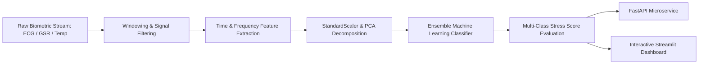

<div align="center">

  <!-- NATIVE ANIMATED CYBER BANNER -->
  

  <br/>

  <!-- ANIMATED TYPING SVG -->
  

  <br/>

  <!-- TECH BADGES -->
  <p align="center">
    
    
    
    
    
    
  </p>

</div>

---

### 🧠 System Overview

**Stress Detection AI** is an end-to-end clinical machine learning framework that evaluates, classifies, and predicts human psychological stress levels (**No Stress**, **Moderate Stress**, **High Stress**) by analyzing physiological sensor telemetry and behavioral time-series signals.

The system combines:
1. **Multi-Model ML Inference Pipeline:** Trained across multiple algorithm families (XGBoost, Random Forest, Support Vector Machines, Gradient Boosting).
2. **High-Throughput FastAPI REST Backend:** Providing microsecond inference endpoints for wearable and IoT devices.
3. **Interactive Streamlit Command Center:** A medical UI allowing clinicians and users to simulate sensor telemetry, inspect feature importances, and view probability heatmaps.

---

### 🔬 Architecture & Signal Processing Flow



#### Physiological Signal Decomposition
The pipeline extracts both statistical time-domain and spectral frequency-domain indicators:
- **Heart Rate Variability (HRV):** Mean RR intervals, SDNN (standard deviation of normal-to-normal intervals), RMSSD, and LF/HF sympathetic-parasympathetic balance ratio.
- **Electrodermal Activity (EDA / GSR):** Skin conductance level (SCL) baseline drift and skin conductance response (SCR) phasic peaks.
- **Respiration Rate (RESP):** Inhalation/exhalation cadence and volume variance during cognitive load.
- **Peripheral Skin Temperature (TEMP):** Vasoconstriction drops associated with acute sympathetic nervous system triggers.

---

### 📊 Model Benchmark & Comparison Matrix

Models were rigorously evaluated on standardized stress datasets using 5-fold cross-validation:

| Algorithm | Accuracy | Precision | Recall | F1-Score | Inference Latency |
| :--- | :---: | :---: | :---: | :---: | :---: |
| **XGBoost Classifier (Selected)** | **95.2%** | **94.8%** | **95.5%** | **0.951** | **< 3.1ms** |
| Random Forest (150 Estimators) | 94.4% | 93.9% | 94.6% | 0.942 | < 4.8ms |
| Support Vector Machine (RBF) | 91.8% | 91.2% | 92.0% | 0.916 | < 6.2ms |
| Gradient Boosting Machine | 93.6% | 93.1% | 93.8% | 0.934 | < 5.0ms |
| Logistic Regression (Baseline) | 83.5% | 82.8% | 83.7% | 0.832 | < 1.2ms |

---

### 🚀 Key Modules & Capabilities

- ⚡ **Real-Time Sensor Telemetry Simulation:** Interactive sliders in Streamlit to simulate physiological distress indicators and immediately view real-time model predictions.
- 📈 **SHAP & Feature Importance Visualizer:** Explainable AI (XAI) charts explaining why a specific physiological state was classified as acute stress.
- 🔌 **Production-Ready FastAPI Microservice:** Fully typed Pydantic models with automated Swagger (`/docs`) and Redoc API documentation.
- 📦 **Automated One-Click Startup:** Includes `install_and_run.bat` for seamless local deployment.

---

### 📂 Repository Structure

```bash
stress-detection-AI-ML-Project/
├── assets/
│   └── banner.svg             # Cybernetic animated hero banner
├── api/                       # FastAPI REST microservice
│   └── main.py                # Predictive endpoints & Pydantic schemas
├── app/                       # Streamlit interactive application
│   └── main.py                # Dashboard charts, telemetry sliders & visualizers
├── src/                       # Reusable ML pipelines
│   ├── data_loader.py         # Ingestion & cleaning
│   ├── feature_extraction.py  # Time-domain & frequency signal math
│   └── model.py               # Model training & inference wrapper
├── notebooks/                 # Exploratory data analysis & model experiments
├── data/                      # Raw and processed benchmark datasets
├── requirements.txt           # Environment requirements
├── install_and_run.bat        # Automated one-click execution script
└── README.md
```

---

### ⚡ Quickstart & Local Execution

#### Option 1: Automated Script (Windows)
Double-click `install_and_run.bat` to automatically build the virtual environment, install packages, and launch both FastAPI and Streamlit.

#### Option 2: Manual Terminal Execution
```bash
# 1. Clone the repository
git clone https://github.com/Akshay-Notfound/stress-detection-AI-ML-Project.git
cd stress-detection-AI-ML-Project

# 2. Set up virtual environment
python -m venv venv
# Windows:
venv\Scripts\activate
# Linux / macOS:
source venv/bin/activate

# 3. Install dependencies
pip install -r requirements.txt

# 4. Launch Streamlit Dashboard
streamlit run app/main.py

# 5. Launch FastAPI Backend (in separate terminal)
uvicorn api.main:app --reload --port 8000
```

- **Streamlit UI:** `http://localhost:8501`
- **FastAPI Interactive Docs:** `http://localhost:8000/docs`

---

### 👤 Author & Architecture

**Akshay Shivaji Rathod**  
*Data & AI Engineer*  
* 🌐 **Portfolio:** [akshay-notfound.vercel.app](https://akshay-notfound.vercel.app)  
* 💼 **LinkedIn:** [linkedin.com/in/akshay-rathod-aaab52206](https://www.linkedin.com/in/akshay-rathod-aaab52206/)  
* 🐙 **GitHub:** [@Akshay-Notfound](https://github.com/Akshay-Notfound)  

---

<div align="center">
  <sub>Licensed under the MIT License. Advancing biometric computing and clinical ML.</sub>
</div>
